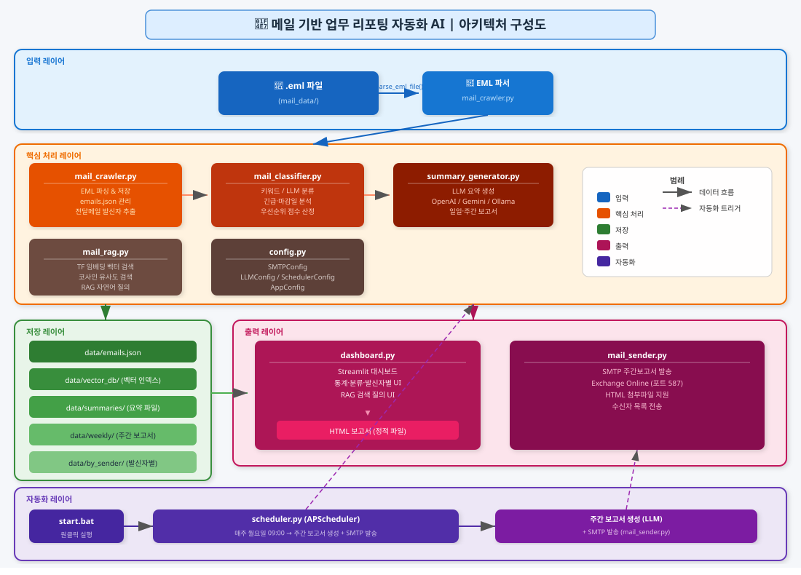
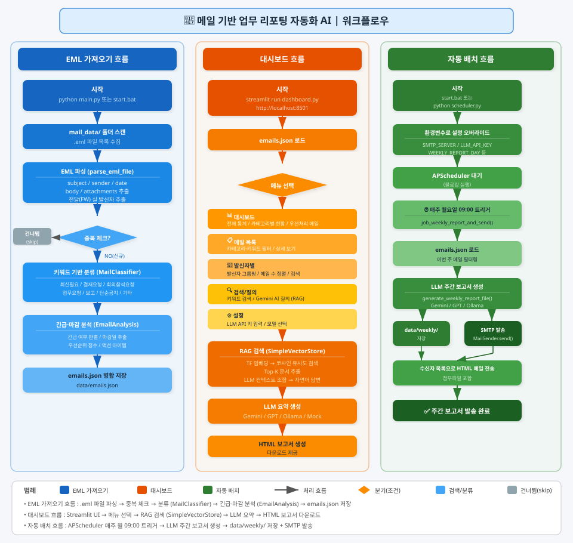

# 📧 메일 기반 업무 리포팅 자동화 AI

---

## 1. 과제 개요

### 과제명

**메일 기반 업무 요약 리포팅 자동화 시스템 구축**

### 추진 배경

| 구분 | 현황 및 문제점 |
|------|---------------|
| 메일 과부하 | 직장인 1인당 하루 평균 30~50통의 업무 메일 수신, 확인/분류에 상당 시간 소요 |
| 우선순위 파악 어려움 | 긴급/중요 메일이 일반 메일에 묻혀 대응 지연 발생 |
| 수동 정리 비효율 | 메일 분류·요약·보고서 작성을 수작업으로 진행하여 반복 업무 증가 |
| 정보 검색 한계 | 과거 메일 확인 시 일일이 검색해야 하며 맥락 파악에 시간 소요 |

### 목적

`.eml` 파일 기반 자동 분류 · AI 요약 보고서 생성 · AI 회신 작성 · 자연어 질의 기능을 통해  
**메일 처리 업무의 자동화 및 효율화**를 실현, 직원들이 핵심 업무에 집중할 수 있는 환경 조성

### 달성 목표 (효율 공수 절감)

| 구분 | As-Is | To-Be | 절감 |
|------|-------|-------|------|
| 메일 확인 및 분류 | 45분/일 | 5분/일 | -40분 |
| 우선순위 파악/정리 | 15분/일 | — | -15분 |
| 주요 메일 요약 정리 | 40분/일 | 15분/일 | -25분 |
| 메일 검색/히스토리 | 20분/일 | 5분/일 | -15분 |
| **합계** | **120분/일** | **25분/일** | **-95분/일 (79% 감소)** |

> 1인 기준 연간 **2.6 MM** 절감 / 10인 팀 기준 연간 **26 MM** 절감

### 기대 효과

| 구분 | 내용 |
|------|------|
| 업무 시간 절감 | 1인당 연간 약 420시간 절감 |
| 대응 속도 향상 | 긴급 메일 식별 시간 80% 단축 (30분 → 5분) |
| 핵심 업무 집중 | 단순 반복 업무 감소로 고부가가치 업무 시간 확보 |
| 업무 가시성 향상 | 대시보드를 통한 메일 현황 한눈에 파악 |

---

## 2. 아키텍처 구성도

```
┌────────────────────────────────────────────────────────────┐
│                        입력 레이어                          │
│   📁 .eml 파일 (mail_data/)                                │
│          │                                                  │
│          ▼  parse_eml_file()                               │
│   📂 EML 파서 (mail_crawler.py)                            │
└──────────────────────┬─────────────────────────────────────┘
                       │
┌──────────────────────▼─────────────────────────────────────┐
│                     핵심 처리 레이어                         │
│  mail_crawler.py  →  mail_classifier.py  →  summary_generator.py │
│  mail_rag.py          config.py                            │
└──────────────────────┬─────────────────────────────────────┘
                       │
┌──────────────────────▼─────────────────────────────────────┐
│                      출력 레이어                             │
│  dashboard.py (Streamlit)   mail_sender.py (SMTP)          │
│  HTML 보고서 생성            주간 보고서 이메일 발송          │
└────────────────────────────────────────────────────────────┘
```

### 모듈 역할

| 모듈 | 역할 |
|------|------|
| `mail_crawler.py` | EML 파일 파싱, `emails.json` 저장/로드, 전달 메일 실 발신자 추출, 중복 체크 |
| `mail_classifier.py` | 7개 카테고리 분류 (키워드/LLM), 긴급·마감일·우선순위(`EmailAnalysis`) 분석 |
| `summary_generator.py` | `OpenAIClient` · `GeminiClient` · `OllamaClient` · `MockLLMClient` 연동, 요약 및 보고서 생성, `max_tokens` 지원 |
| `mail_rag.py` | `SimpleVectorStore` TF 임베딩 기반 코사인 유사도 검색 + LLM 자연어 질의 |
| `dashboard.py` | Streamlit 대시보드 (회신 작성·AI 질의·검색·보고서 다운로드) |
| `mail_sender.py` | SMTP(Exchange Online) 주간 보고서 HTML 발송, 첨부파일 지원 |
| `scheduler.py` | APScheduler 기반 주간 배치 자동화, 환경변수로 설정 오버라이드 |
| `config.py` | `SMTPConfig` · `LLMConfig` · `SchedulerConfig` · `AppConfig` 설정 관리, `save_llm_config` / `load_llm_config` (max_tokens 포함) |

---

## 3. 워크플로우

```
[start.bat / python main.py]
       │
       ▼
mail_data/ 폴더 스캔 → .eml 파일 목록 수집
       │
       ▼
EML 파싱 (parse_eml_file)
subject / sender / date / body / attachments 추출
전달(FW) 메일의 경우 본문에서 실 발신자 추출
       │
       ▼
중복 체크 (eml_ID 비교) → 신규만 처리 (--force 시 전체 재파싱)
       │
       ▼
키워드 기반 분류 (MailClassifier)
카테고리: 회신필요 / 결재요청 / 회의참석요청 / 업무요청 / 보고/공유 / 단순공지 / 기타
       │
       ▼
긴급·마감 분석 (EmailAnalyzer)
긴급 여부 / 마감일 / 우선순위 점수 / 액션 아이템 추출
       │
       ▼
emails.json 병합 저장 (data/emails.json)
       │
       ▼
Streamlit 대시보드 → http://localhost:8501
```

---

## 4. 주요 기능

| 기능 | 설명 |
|------|------|
| EML 일괄 파싱 | `mail_data/` 폴더의 `.eml` 파일 자동 파싱, 중복 건너뜀 (`--force` 재파싱) |
| 자동 분류 | 회신필요 / 결재요청 / 회의참석요청 / 단순공지 / 보고/공유 / 업무요청 / 기타 (7개 카테고리) |
| 발신자 추출 | 전달(FW) 메일의 실 발신자를 본문에서 정확히 추출 |
| 긴급·마감 분석 | 긴급 여부 자동 판별, 마감일 추출, 우선순위 점수 산정, 액션 아이템 추출 |
| 회신 필요 메일 관리 | 회신필요 메일 목록 스크롤 UI + LLM 메일 요약 + LLM 회신 초안 자동 작성 |
| AI 질의 | 설정된 LLM으로 메일 데이터 대상 자연어 질의 (점수 기반 관련 메일 우선 검색) |
| Streamlit 대시보드 | 통계·우선순위·발신자별 분류 웹 UI |
| HTML 보고서 | Chart.js 기반 시각화 포함 HTML 보고서 자동 생성 |
| RAG 질의 | TF 임베딩(`SimpleVectorStore`) + 저장된 LLM 설정으로 자연어 질의 |
| 주간 보고서 자동 발송 | Exchange Online SMTP 기반 HTML 메일 자동 발송 (첨부파일 지원) |

---

## 5. 빠른 시작

### 설치

```bash
pip install -r requirements.txt
```

### EML 파일 준비

Outlook에서 메일을 `.eml` 형식으로 내보낸 뒤 `mail_data/` 폴더에 직접 넣습니다.

```
mail_reporter/
└── mail_data/
    ├── 2026-05-11 0909_유재철_전달 기간계 오류개선.eml
    └── ...
```

### 실행

```bash
# Windows 더블클릭 (EML 가져오기 → 대시보드 자동 실행)
start.bat

# 또는 터미널
python main.py                        # EML 가져오기 + 대시보드
python main.py import-eml             # EML 파싱만
python main.py import-eml --force     # 모든 EML 재파싱
python main.py import-eml --llm       # LLM 기반 분류로 가져오기
python main.py dashboard              # 대시보드만
python main.py report                 # HTML 보고서 생성
python main.py query                  # 터미널 대화형 질의

# 배치 스케줄러 (주간 보고서 자동 발송)
python scheduler.py
```

브라우저에서 **http://localhost:8501** 접속

---

## 6. 대시보드 메뉴

| 메뉴 | 내용 |
|------|------|
| 📊 대시보드 | 전체 통계·카테고리별 현황·회신필요 메일 (LLM 요약/회신 작성)·우선처리 메일 |
| 📬 메일 목록 | 카테고리/키워드 필터링·상세 보기 |
| 📁 발신자별 | 이름+이메일 표시·검색·메일 수 순 정렬 |
| 🔍 검색/질의 | 키워드 검색 탭 + AI 질의 탭 (설정된 LLM 사용) |
| ⚙️ 설정 | LLM 제공자·API 키·모델명·Max Tokens 설정 및 저장 |

### 회신 필요 메일 섹션

대시보드 상단에 표시되는 회신필요 메일 전용 섹션입니다.

- **스크롤 가능한 메일 목록**: 고정 높이 영역 내에서 스크롤로 메일 선택
- **📝 LLM 메일 요약**: 선택한 메일을 LLM으로 3~5줄 요약
- **✍️ LLM 회신 작성**: 회신 의도 입력 → 간결하고 정중한 전문 회신 초안 자동 생성

### AI 질의 탭

- 설정 탭에서 저장된 LLM(OpenAI / Gemini / Ollama)을 자동으로 사용
- 별도 API 키 입력 불필요
- 점수 기반 관련 메일 우선 검색 (발신자 일치: 100점, 제목 포함: 50점, 본문 포함: 10점)

---

## 7. LLM 연동

### 지원 LLM

| 클라이언트 | 클래스 | 기본 모델 | 비고 |
|-----------|--------|----------|------|
| OpenAI | `OpenAIClient` | `gpt-4o-mini` | `OPENAI_API_KEY` 환경변수 또는 설정 탭 |
| Google Gemini | `GeminiClient` | `gemini-2.5-flash` | `GEMINI_API_KEY` 환경변수 또는 설정 탭 |
| Ollama (로컬) | `OllamaClient` | `llama3` | `http://localhost:11434` |
| Mock (테스트) | `MockLLMClient` | — | API 키 없이 동작 확인 |

### LLM 설정 (대시보드 설정 탭)

설정 탭에서 한 번 저장하면 모든 LLM 기능에서 자동으로 재사용됩니다.

| 항목 | 설명 |
|------|------|
| LLM 제공자 | openai / gemini / ollama 중 선택 |
| API 키 | OpenAI 또는 Gemini API 키 입력 (Ollama는 불필요) |
| 모델명 | 사용할 모델 (예: `gpt-4o-mini`, `gemini-2.5-flash`, `llama3`) |
| Max Tokens | LLM 응답 최대 토큰 수 (기본값: 1000, 범위: 100~8000) |

저장된 설정은 `data/llm_config.json`에 유지됩니다.

### AI 질의 사용법

1. **⚙️ 설정** 탭에서 LLM 제공자 및 API 키 저장
2. **🔍 검색/질의** → **🤖 AI 질의** 탭 선택
3. 자연어로 질문 입력 후 **질문하기** 클릭

```
예시 질문:
  심우송님이 보낸 메일 내용 요약해줘
  이번 주 회신해야 할 메일 정리해줘
  결재 요청 중 아직 처리 안 된 건 있어?
  실시간 시스템 관련 메일 알려줘
```

---

## 8. 스케줄러 환경변수 설정

`scheduler.py`는 아래 환경변수를 통해 설정을 오버라이드할 수 있습니다.

| 환경변수 | 기본값 | 설명 |
|---------|-------|------|
| `SMTP_SERVER` | `smtp.office365.com` | Exchange Online SMTP |
| `SMTP_PORT` | `587` | SMTP 포트 |
| `MAIL_EMAIL` | `youjin0404@hanwha.com` | 발신 이메일 |
| `MAIL_PASSWORD` | — | 이메일 비밀번호 |
| `MAIL_RECIPIENTS` | — | 수신자 목록 (쉼표 구분) |
| `LLM_PROVIDER` | `openai` | `openai` / `gemini` / `ollama` |
| `LLM_API_KEY` | — | LLM API 키 |
| `LLM_MODEL` | `gpt-4o-mini` | 사용할 모델명 |
| `LLM_MAX_TOKENS` | `1000` | LLM 최대 생성 토큰 수 |
| `LLM_BASE_URL` | — | Ollama 등 로컬 LLM URL |
| `WEEKLY_REPORT_DAY` | `0` | 보고서 발송 요일 (0=월요일) |
| `WEEKLY_REPORT_TIME` | `09:00` | 발송 시각 |
| `LOG_FILE` | `./data/scheduler.log` | 스케줄러 로그 경로 |

---

## 9. 프로젝트 구조

```
mail_reporter/
├── mail_data/              ← .eml 파일을 여기에 넣으세요
├── data/
│   ├── emails.json         ← 파싱된 메일 데이터 (자동 생성)
│   ├── llm_config.json     ← LLM 설정 (provider/api_key/model/max_tokens)
│   ├── summaries/          ← 생성된 요약/HTML 보고서
│   ├── vector_db/          ← TF 임베딩 인덱스 (index.json)
│   ├── weekly/             ← 주간 보고서
│   └── by_sender/          ← 발신자별 분류
├── docs/
│   └── overview.html       ← 프로젝트 개요 HTML 문서
├── dashboard.py            # Streamlit 대시보드 UI (회신 작성·AI 질의 포함)
├── main.py                 # CLI 진입점
├── mail_crawler.py         # EML 파싱 모듈 (Email 데이터클래스, ForwardedEmailInfo)
├── mail_classifier.py      # 메일 분류 모듈 (MailClassifier, EmailAnalysis, EmailAnalyzer)
├── summary_generator.py    # 보고서 생성 + LLM 클라이언트 (OpenAI/Gemini/Ollama/Mock)
├── mail_rag.py             # 벡터 검색 + RAG 질의 (SimpleVectorStore)
├── mail_sender.py          # SMTP 보고서 발송 (MailSender)
├── scheduler.py            # 배치 스케줄러 (APScheduler, 환경변수 설정)
├── config.py               # 설정 관리 (save_llm_config/load_llm_config, max_tokens 포함)
├── start.bat               # Windows 원클릭 실행 (EML 가져오기 → 대시보드)
└── requirements.txt
```

---

## 10. 의존 패키지

```
streamlit>=1.30.0           # 웹 대시보드
pandas>=2.0.0               # 데이터 처리
openai>=1.0.0               # OpenAI API (선택)
google-generativeai>=0.7.0  # Gemini API (선택)
requests>=2.31.0            # HTTP 요청 (Ollama 연동)
msal>=1.20.0                # Microsoft 365 / Graph API 인증
APScheduler>=3.10.0         # 배치 스케줄러
pytest>=7.0.0               # 개발/테스트
```

---

## 11. 라이선스

MIT License


### 과제명

**메일 기반 업무 요약 리포팅 자동화 시스템 구축**

### 추진 배경

| 구분 | 현황 및 문제점 |
|------|---------------|
| 메일 과부하 | 직장인 1인당 하루 평균 30~50통의 업무 메일 수신, 확인/분류에 상당 시간 소요 |
| 우선순위 파악 어려움 | 긴급/중요 메일이 일반 메일에 묻혀 대응 지연 발생 |
| 수동 정리 비효율 | 메일 분류·요약·보고서 작성을 수작업으로 진행하여 반복 업무 증가 |
| 정보 검색 한계 | 과거 메일 확인 시 일일이 검색해야 하며 맥락 파악에 시간 소요 |

### 목적

`.eml` 파일 기반 자동 분류 · AI 요약 보고서 생성 · 자연어 질의 기능을 통해  
**메일 처리 업무의 자동화 및 효율화**를 실현, 직원들이 핵심 업무에 집중할 수 있는 환경 조성

### 달성 목표 (효율 공수 절감)

| 구분 | As-Is | To-Be | 절감 |
|------|-------|-------|------|
| 메일 확인 및 분류 | 45분/일 | 5분/일 | -40분 |
| 우선순위 파악/정리 | 15분/일 | — | -15분 |
| 주요 메일 요약 정리 | 40분/일 | 15분/일 | -25분 |
| 메일 검색/히스토리 | 20분/일 | 5분/일 | -15분 |
| **합계** | **120분/일** | **25분/일** | **-95분/일 (79% 감소)** |

> 1인 기준 연간 **2.6 MM** 절감 / 10인 팀 기준 연간 **26 MM** 절감

### 기대 효과

| 구분 | 내용 |
|------|------|
| 업무 시간 절감 | 1인당 연간 약 420시간 절감 |
| 대응 속도 향상 | 긴급 메일 식별 시간 80% 단축 (30분 → 5분) |
| 핵심 업무 집중 | 단순 반복 업무 감소로 고부가가치 업무 시간 확보 |
| 업무 가시성 향상 | 대시보드를 통한 메일 현황 한눈에 파악 |

---

## 2. 아키텍처 구성도



<details>
<summary>텍스트 버전 보기</summary>

```
┌──────────────────────────────────────────────────────────────────────────────────────┐
│                                    입력 레이어                                        │
│                                                                                      │
│   📁 .eml 파일 (mail_data/)                                                          │
│          │                                                                           │
│          └──────────────┬────────────────────────────────────────────────────────────│
│                         ▼  parse_eml_file()                                          │
│                📂 EML 파서 (mail_crawler.py)                                         │
└─────────────────────────┬────────────────────────────────────────────────────────────┘
                          │
┌─────────────────────────▼────────────────────────────────────────────────────────────┐
│                             핵심 처리 레이어                                          │
│                                                                                      │
│  ┌──────────────────────┐  ┌───────────────────────┐  ┌───────────────────────────┐ │
│  │   mail_crawler.py    │  │  mail_classifier.py   │  │   summary_generator.py    │ │
│  │──────────────────────│  │───────────────────────│  │───────────────────────────│ │
│  │ EML 파싱 & 저장      │─▶│ 키워드/LLM 분류       │  │ LLM 요약 생성             │ │
│  │ emails.json 관리     │  │ 긴급·마감일 분석       │  │ OpenAI / Gemini / Ollama  │ │
│  │ 전달메일 발신자추출   │  │ 우선순위 점수 산정     │  │ 일일·주간 보고서          │ │
│  └──────────────────────┘  └───────────────────────┘  └───────────────────────────┘ │
│                                                                                      │
│  ┌──────────────────────┐  ┌───────────────────────┐                                │
│  │     mail_rag.py      │  │       config.py       │                                │
│  │──────────────────────│  │───────────────────────│                                │
│  │ TF 임베딩 벡터검색   │  │ SMTPConfig            │                                │
│  │ 코사인 유사도 검색   │  │ LLMConfig             │                                │
│  │ RAG 자연어 질의      │  │ SchedulerConfig       │                                │
│  └──────────────────────┘  │ AppConfig             │                                │
│                            └───────────────────────┘                                │
└──────────────────┬───────────────────────────────────────────────────────────────────┘
                   │
     ┌─────────────┴─────────────┐
     ▼                           ▼
┌──────────────────┐   ┌─────────────────────────────────────────────────────────────┐
│   저장 레이어     │   │                       출력 레이어                            │
│                  │   │                                                             │
│ data/            │   │  ┌─────────────────────────┐  ┌──────────────────────────┐ │
│  emails.json     │──▶│  │      dashboard.py       │  │     mail_sender.py       │ │
│  vector_db/      │   │  │─────────────────────────│  │──────────────────────────│ │
│  summaries/      │   │  │ Streamlit 대시보드       │  │ SMTP 주간보고서 발송     │ │
│  weekly/         │   │  │ 통계·분류·발신자별 UI    │  │ HTML 첨부파일 지원       │ │
│  by_sender/      │   │  │ RAG 검색 질의 UI        │  │ 수신자 목록 전송         │ │
│                  │   │  └────────────┬────────────┘  └──────────────────────────┘ │
└──────────────────┘   │               ▼                                             │
                       │      HTML 보고서 (정적 파일)                                 │
                       └─────────────────────────────────────────────────────────────┘
                                        ▲
┌───────────────────────────────────────┴─────────────────────────────────────────────┐
│                                  자동화 레이어                                        │
│                                                                                      │
│   start.bat ──▶ scheduler.py (APScheduler)                                          │
│                       │                                                             │
│                       └── 매주 월요일 09:00                                          │
│                              ├── 주간 보고서 생성 (LLM)                              │
│                              └── SMTP 발송 (mail_sender.py)                         │
└──────────────────────────────────────────────────────────────────────────────────────┘
```

</details>

### 모듈 역할

| 모듈 | 역할 |
|------|------|
| `mail_crawler.py` | EML 파일 파싱, `emails.json` 저장/로드, 전달 메일 실 발신자 추출, 중복 체크 |
| `mail_classifier.py` | 7개 카테고리 분류 (키워드/LLM), 긴급·마감일·우선순위(`EmailAnalysis`) 분석 |
| `summary_generator.py` | `OpenAIClient` · `GeminiClient` · `OllamaClient` · `MockLLMClient` 연동, 요약 및 보고서 생성 |
| `mail_rag.py` | `SimpleVectorStore` TF 임베딩 기반 코사인 유사도 검색 + LLM 자연어 질의 |
| `dashboard.py` | Streamlit 대시보드 (시각화·검색·보고서 다운로드) |
| `mail_sender.py` | SMTP(Exchange Online) 주간 보고서 HTML 발송, 첨부파일 지원 |
| `scheduler.py` | APScheduler 기반 주간 배치 자동화, 환경변수로 설정 오버라이드 |
| `config.py` | `SMTPConfig` · `LLMConfig` · `SchedulerConfig` · `AppConfig` 설정 관리 |

---

## 3. 워크플로우



<details>
<summary>텍스트 버전 보기</summary>

```
┌──────────────────────────────────────────────────────────────────────────────────────────┐
│                              EML 가져오기 흐름                                            │
│                                                                                          │
│   python main.py  또는  start.bat                                                        │
│       │                                                                                  │
│       ▼                                                                                  │
│   mail_data/ 폴더 스캔 → .eml 파일 목록 수집                                             │
│       │                                                                                  │
│       ▼                                                                                  │
│   EML 파싱 (parse_eml_file)                                                              │
│   subject / sender / date / body / attachments 추출                                      │
│   전달(FW) 메일의 경우 본문에서 실 발신자 추출                                             │
│       │                                                                                  │
│       ▼                                                                                  │
│   중복 체크 (eml_ ID 비교)                                                                │
│   ├── 이미 존재 → 건너뜀 (--force 옵션 시 재파싱)                                        │
│   └── 신규 →                                                                            │
│           ▼                                                                              │
│       키워드 기반 분류 (MailClassifier)                                                   │
│       카테고리: 회신필요 / 결재요청 / 회의참석요청 / 업무요청 / 보고/공유 / 단순공지 / 기타 │
│           │                                                                              │
│           ▼                                                                              │
│       긴급·마감 분석 (EmailAnalyzer → EmailAnalysis)                                     │
│       긴급 여부 판별 / 마감일 추출 / 우선순위 점수 산정 / 액션 아이템 추출                 │
│           │                                                                              │
│           ▼                                                                              │
│       emails.json 병합 저장 (data/emails.json)                                           │
└──────────────────────────────────────────────────────────────────────────────────────────┘

┌──────────────────────────────────────────────────────────────────────────────────────────┐
│                              대시보드 흐름                                                │
│                                                                                          │
│   [시작] streamlit run dashboard.py → http://localhost:8501                              │
│       │                                                                                  │
│       ▼                                                                                  │
│   emails.json 로드 → 메뉴 선택                                                            │
│       │                                                                                  │
│       ├── [대시보드]  전체 통계 카드 / 카테고리별 현황 / 우선처리 메일 목록                │
│       │                                                                                  │
│       ├── [메일 목록] 카테고리·키워드 필터 / 상세 보기                                    │
│       │                                                                                  │
│       ├── [발신자별]  발신자 그룹핑 / 메일 수 정렬 / 검색                                 │
│       │                                                                                  │
│       ├── [검색/질의] ─┬─ 키워드 검색 (전문 매칭)                                        │
│       │               └─ Gemini AI 질의 (RAG)                                            │
│       │                       │                                                          │
│       │                       ▼                                                          │
│       │               TF 임베딩 (SimpleVectorStore) → 코사인 유사도 검색 (Top-K)         │
│       │               → LLM 컨텍스트 조합 → 자연어 답변 반환                             │
│       │                                                                                  │
│       └── [설정]      LLM API 키 입력 / 모델 선택                                        │
│                               │                                                          │
│                               ▼                                                          │
│                   LLM 요약 생성 (Gemini / GPT / Ollama / Mock)                           │
│                               │                                                          │
│                               ▼                                                          │
│                   HTML 보고서 생성 → 다운로드                                             │
└──────────────────────────────────────────────────────────────────────────────────────────┘

┌──────────────────────────────────────────────────────────────────────────────────────────┐
│                              자동 배치 흐름 (scheduler.py)                                │
│                                                                                          │
│   [시작] start.bat 또는 python scheduler.py                                              │
│       │  환경변수(SMTP_SERVER, LLM_API_KEY, WEEKLY_REPORT_DAY 등)로 설정 오버라이드      │
│       ▼                                                                                  │
│   APScheduler 대기                                                                        │
│       │                                                                                  │
│       └── 매주 월요일 09:00 ──▶ job_weekly_report_and_send()                             │
│                                       │                                                  │
│                                       ▼                                                  │
│                               emails.json 로드 → 이번 주 메일 필터                        │
│                                       │                                                  │
│                                       ▼                                                  │
│                               LLM 주간 보고서 생성 (generate_weekly_report_file)          │
│                                       │                                                  │
│                                       ├── data/weekly/ 저장                              │
│                                       │                                                  │
│                                       └── SMTP 발송 (MailSender.send)                    │
│                                               HTML + 첨부파일 형식 메일 전송              │
└──────────────────────────────────────────────────────────────────────────────────────────┘
```

</details>

---

## 4. 주요 기능

| 기능 | 설명 |
|------|------|
| EML 일괄 파싱 | `mail_data/` 폴더의 `.eml` 파일 자동 파싱, 중복 건너뜀(`--force` 재파싱) |
| 자동 분류 | 회신필요 / 결재요청 / 회의참석요청 / 단순공지 / 보고/공유 / 업무요청 / 기타 (7개 카테고리) |
| 발신자 추출 | 전달(FW) 메일의 실 발신자를 본문에서 정확히 추출 |
| 긴급·마감 분석 | 긴급 여부 자동 판별, 마감일 추출, 우선순위 점수 산정, 액션 아이템 추출 |
| Streamlit 대시보드 | 통계·우선순위·발신자별 분류 웹 UI |
| HTML 보고서 | Chart.js 기반 시각화 포함 HTML 보고서 자동 생성 |
| RAG 질의 | TF 임베딩(`SimpleVectorStore`) + Gemini / GPT AI 자연어 질의 |
| 주간 보고서 자동 발송 | Exchange Online SMTP 기반 HTML 메일 자동 발송 (첨부파일 지원) |

---

## 5. 빠른 시작

### 설치

```bash
pip install -r requirements.txt
```

### EML 파일 준비

Outlook에서 메일을 `.eml` 형식으로 내보낸 뒤 `mail_data/` 폴더에 직접 넣습니다.

```
mail_reporter/
└── mail_data/
    ├── 2026-05-11 0909_유재철_전달 기간계 오류개선.eml
    └── ...
```

### 실행

```bash
# Windows 더블클릭 (EML 가져오기 → 대시보드 자동 실행)
start.bat

# 또는 터미널
python main.py                        # EML 가져오기 + 대시보드
python main.py import-eml             # EML 파싱만
python main.py import-eml --force     # 모든 EML 재파싱
python main.py dashboard              # 대시보드만
python main.py report                 # HTML 보고서 생성
python main.py query                  # 터미널 대화형 질의

# 배치 스케줄러 (주간 보고서 자동 발송)
python scheduler.py
```

브라우저에서 **http://localhost:8501** 접속

---

## 6. 대시보드 메뉴

| 메뉴 | 내용 |
|------|------|
| 대시보드 | 전체 통계·카테고리별 현황·우선처리 메일 |
| 메일 목록 | 카테고리/키워드 필터링·상세 보기 |
| 발신자별 | 이름+이메일 표시·검색·메일 수 순 정렬 |
| 검색/질의 | 키워드 탭 + Gemini AI 탭 |
| 설정 | LLM API 키·모델 설정 |

---

## 7. LLM 연동

### 지원 LLM

| 클라이언트 | 클래스 | 기본 모델 | 비고 |
|-----------|--------|----------|------|
| OpenAI | `OpenAIClient` | `gpt-4o-mini` | `OPENAI_API_KEY` 환경변수 |
| Google Gemini | `GeminiClient` | `gemini-2.5-flash` | `GEMINI_API_KEY` 환경변수 |
| Ollama (로컬) | `OllamaClient` | `llama3` | `http://localhost:11434` |
| Mock (테스트) | `MockLLMClient` | — | API 키 없이 동작 확인 |

### Gemini AI 질의 사용법

1. **검색/질의** 메뉴 → **Gemini AI 질의** 탭
2. [Google AI Studio](https://aistudio.google.com/app/apikey) 에서 API 키 발급
3. API 키 입력 후 모델 선택 (`gemini-2.5-flash` 권장)
4. 자연어로 질문 입력

```
예시 질문:
  이번 주 회신해야 할 메일 정리해줘
  유재철님이 전달한 메일 요약해줘
  결재 요청 중 아직 처리 안 된 건 있어?
```

---

## 8. 스케줄러 환경변수 설정

`scheduler.py`는 아래 환경변수를 통해 설정을 오버라이드할 수 있습니다.

| 환경변수 | 기본값 | 설명 |
|---------|-------|------|
| `SMTP_SERVER` | `smtp.office365.com` | Exchange Online SMTP |
| `SMTP_PORT` | `587` | SMTP 포트 |
| `MAIL_EMAIL` | `youjin0404@hanwha.com` | 발신 이메일 |
| `MAIL_PASSWORD` | — | 이메일 비밀번호 |
| `MAIL_RECIPIENTS` | — | 수신자 목록 (쉼표 구분) |
| `LLM_PROVIDER` | `openai` | `openai` / `ollama` |
| `LLM_API_KEY` | — | LLM API 키 |
| `LLM_MODEL` | `gpt-4o-mini` | 사용할 모델명 |
| `LLM_BASE_URL` | — | Ollama 등 로컬 LLM URL |
| `WEEKLY_REPORT_DAY` | `0` | 보고서 발송 요일 (0=월요일) |
| `WEEKLY_REPORT_TIME` | `09:00` | 발송 시각 |
| `LOG_FILE` | `./data/scheduler.log` | 스케줄러 로그 경로 |

---

## 9. 프로젝트 구조

```
mail_reporter/
├── mail_data/              ← .eml 파일을 여기에 넣으세요
├── data/
│   ├── emails.json         ← 파싱된 메일 데이터 (자동 생성)
│   ├── summaries/          ← 생성된 요약/HTML 보고서
│   ├── vector_db/          ← TF 임베딩 인덱스 (index.json)
│   ├── weekly/             ← 주간 보고서
│   └── by_sender/          ← 발신자별 분류
├── docs/
│   └── generate_diagrams.py
├── dashboard.py            # Streamlit 대시보드 UI
├── main.py                 # CLI 진입점
├── mail_crawler.py         # EML 파싱 모듈 (Email 데이터클래스)
├── mail_classifier.py      # 메일 분류 모듈 (MailClassifier, EmailAnalysis)
├── summary_generator.py    # 보고서 생성 + LLM 클라이언트 (OpenAI/Gemini/Ollama/Mock)
├── mail_rag.py             # 벡터 검색 + RAG 질의 (SimpleVectorStore)
├── mail_sender.py          # SMTP 보고서 발송 (MailSender)
├── scheduler.py            # 배치 스케줄러 (APScheduler, 환경변수 설정)
├── config.py               # 설정 데이터클래스 (SMTPConfig/LLMConfig/SchedulerConfig/AppConfig)
├── start.bat               # Windows 원클릭 실행 (EML 가져오기 → 대시보드)
└── requirements.txt
```

---

## 10. 의존 패키지

```
streamlit>=1.30.0       # 웹 대시보드
pandas>=2.0.0           # 데이터 처리
openai>=1.0.0           # OpenAI API (선택)
google-generativeai>=0.7.0  # Gemini API (선택)
requests>=2.31.0        # HTTP 요청 (Ollama 연동)
msal>=1.20.0            # Microsoft 365 / Graph API 인증
APScheduler>=3.10.0     # 배치 스케줄러
pytest>=7.0.0           # 개발/테스트
```

---

## 11. 라이선스

MIT License

